# INTRIXLABS
<p align="center">
  
</p>

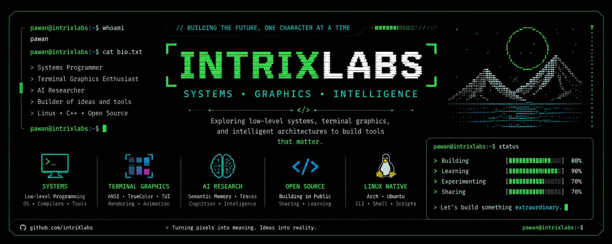

# Research and Projects:

### AksChitraSpecifics -
<p align="center">
  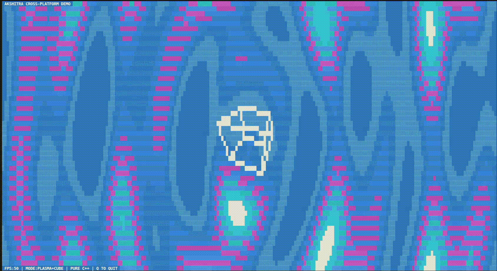
  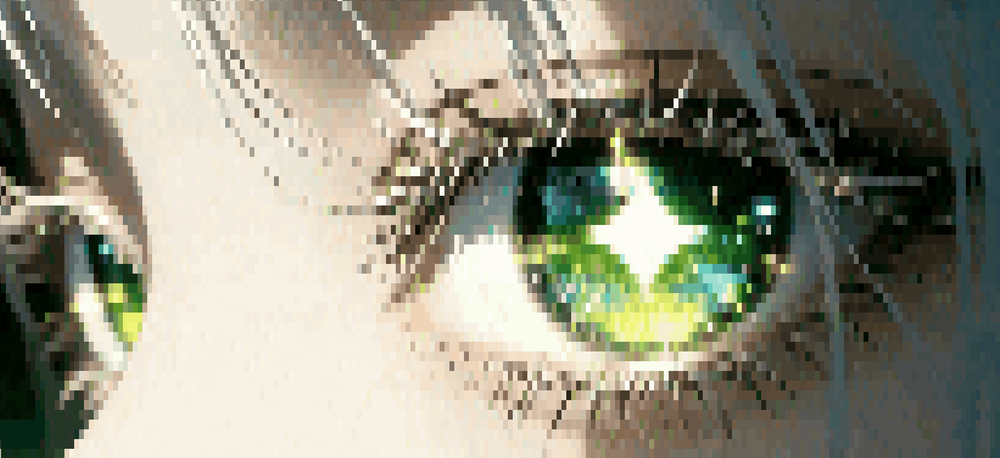
</p>

---

### ANSI Rendering Experiments -
<p align="center">
  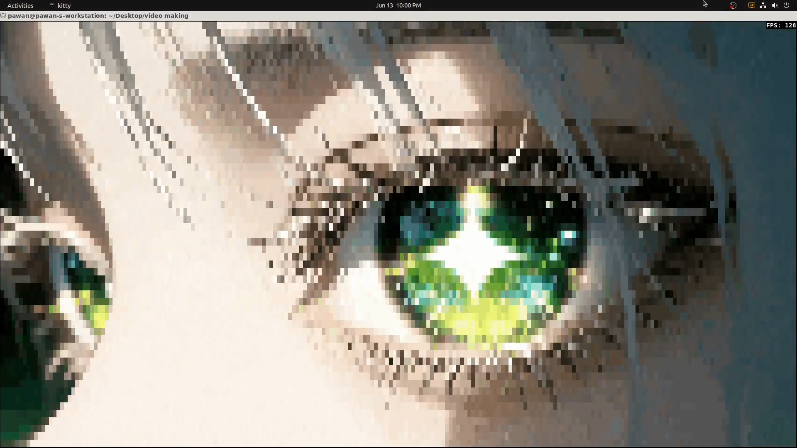
  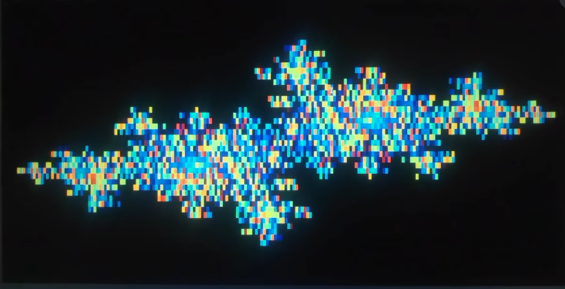
  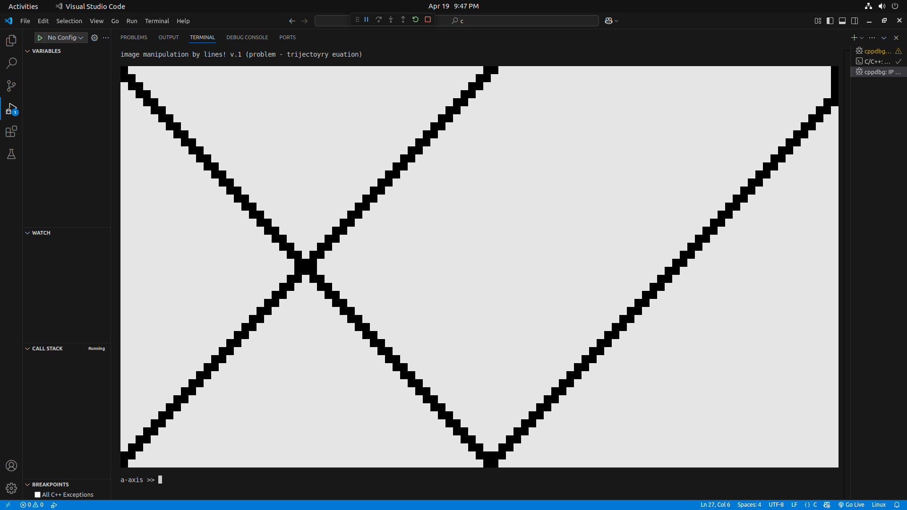
</p>

---

### AksChitra Features -
<p align="center">
  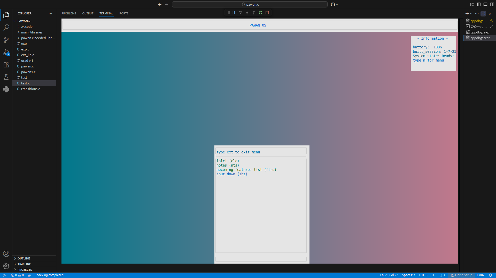
  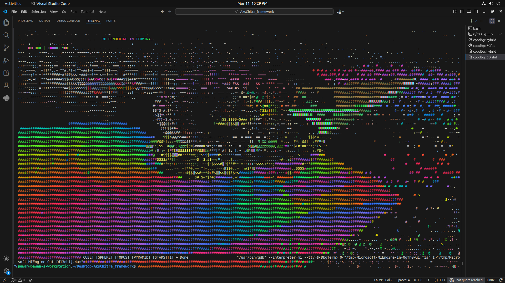
  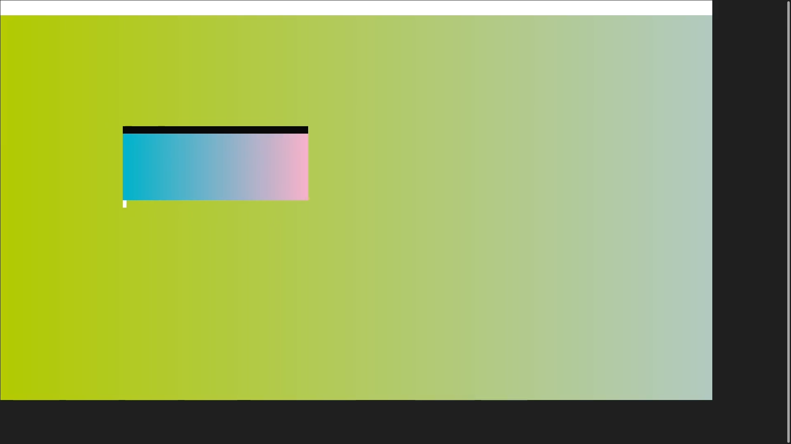
</p>

---

### Utilities & Tools -
<p align="center">
  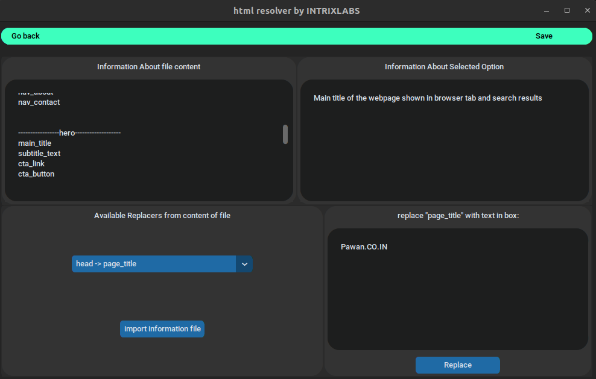
  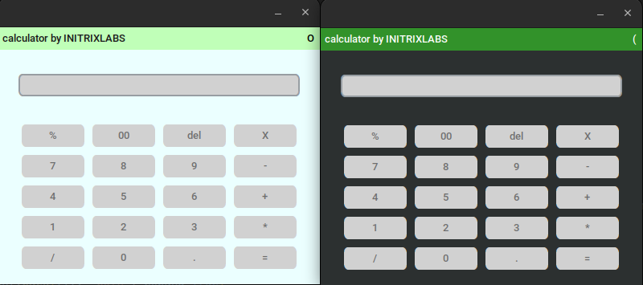
  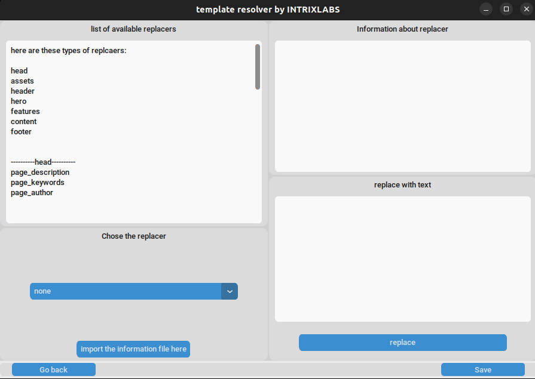
  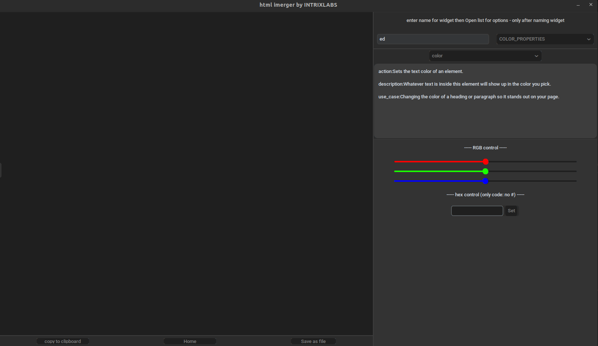
  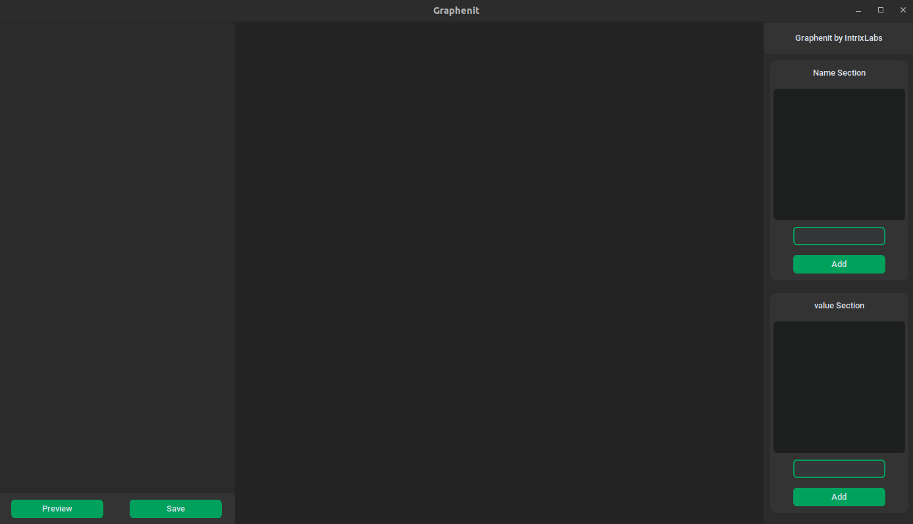
  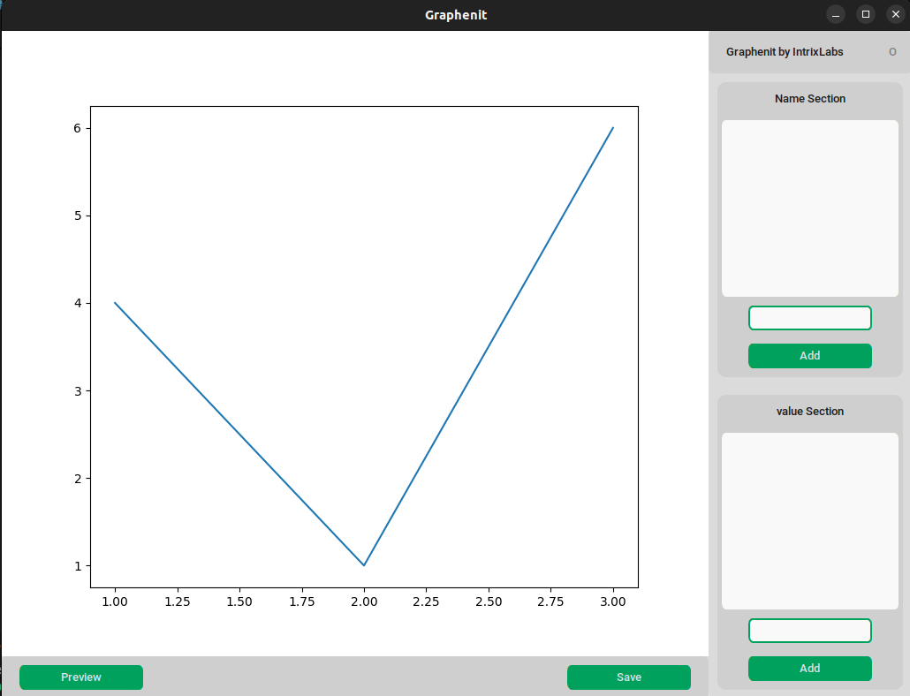
</p>

# 💫 About Me:
Hi, i am pawan. <br>
Currently doing my bachelor's in computer science and engineering and learning new technologies.<br>
intrixlabs is my way to separate my ideas from me.


🔭 I’m currently working on:<br>
    🎨 Terminal Graphics – Understanding the undiscovered.<br>
    🧠 Trace Network – Experimental semantic memory architecture<br>
    🌐 Networking – wired and wireless from scratch<br>
    ⚡ IntrixLabs – Open-source systems and graphics projects<br><br>

👯 I’m looking to collaborate on:<br>
    Low-level programming, rendering engines, terminal graphics,<br>
    semantic architectures and open-source system software.<br><br>
🌱 I’m currently learning:<br>
    Rendering Algorithms • fundamental concepts • Distributed Systems<br>
    AI Architectures • Operating Systems • system design<br><br>
💬 Ask me about:<br>
    C, C++, Linux, Terminal Graphics, ANSI Escape Codes,<br>
    Rendering, Low-level Programming or AI ideas.<br><br>
⚡ Fun fact:<br>
    most of my experiments end up being my research topics or strange implementations.

## 📋 programming career:
```
My programming career/
   ├─ C/
   │  ├─ private/
   │  └─ public/
   │     └─ multiple c regarded ansi libs
   ├─ CPP/
   │  ├─ private/
   │  │  ├─ akschitra_foundation
   │  │  ├─ akschitra_offficial
   │  │  ├─ iristix
   │  │  └─ itrenx
   │  └─ public/
   │     ├─ experimental libs/
   │     │  └─ springless
   │     ├─ normal graphics/
   │     │  ├─ aici
   │     │  └─ fog
   │     └─ terminal graphics/
   │        ├─ akschitra_initiality
   │        ├─ animBye
   │        ├─ anukrascii
   │        ├─ divae
   │        ├─ excii
   │        ├─ fadescii
   │        ├─ kittacacii
   │        ├─ sclide
   │        ├─ shiocus
   │        ├─ simulaii
   │        └─ trainscii
   ├─ Python/
   │  ├─ private/
   │  │  ├─ appimage based packed software/
   │  │  │  └─ in source codes
   │  │  ├─ html imerger
   │  │  └─ websiter
   │  └─ public/
   │     └─ Appimage based packed softwares/
   │        ├─ graphenit
   │        ├─ html resolver
   │        ├─ Noteline
   │        └─ sharenit
   └─ WebDev/
      ├─ gitophile.vercel.app
      └─ intrixlabs.vercel.app
```

## personal philosophy:
- terminal graphics is not my main focus, but it is my way to understand the rendering and graphics concepts, i use terminal graphics to understand the rendering concepts and then implement them in my own way in other languages and platforms.
- i does both types of projects: 
  - private projects: which are not open-source and are my own experiments and research topics.
  - public projects: which are open-source and are available for everyone to use and contribute.
- my projects share two types mostly:
    - fun projects: such as kittacacii, trainscii, etc. which are foundation for others to build upon and learn from.
    - serious developer tools: such as aici, excii, etc. which are useful for developers and are used in real-world applications.
- i myself learning new technologies and concepts almost every hour, so my projects are always evolving and changing, and i am always looking for new ways to improve them and make them better.
- i rarely share my serious projects, mostly i keep them private.
- i do not do serious projects due to lack of time and learning process, which is why i use knowledge to implement them on small fun projects and then use the same foundations in serious projects.

## 🌐 Socials:
[](https://www.instagram.com/Intrixlabs/) 
[](https://www.linkedin.com/in/intrinxlabs-a195393a2/) 
[](https://www.reddit.com/user/Technical_Chip5906/) 
[](https://www.youtube.com/@intrinXlabs) 
[](https://mastodon.social/@intrixlabs) 
[](mailto:intrixlabs@gmail.com) 

# 💻 Tech Stack:
             
# 📊 GitHub Stats:
<br/>
<br/>


---

```bash
$ philosophy

"Programming is my way of turning thoughts into consequences." - Pawan (INTRIXLABS)